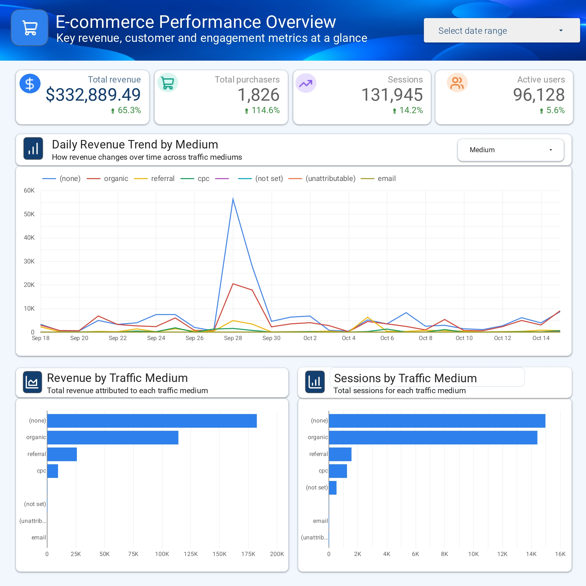
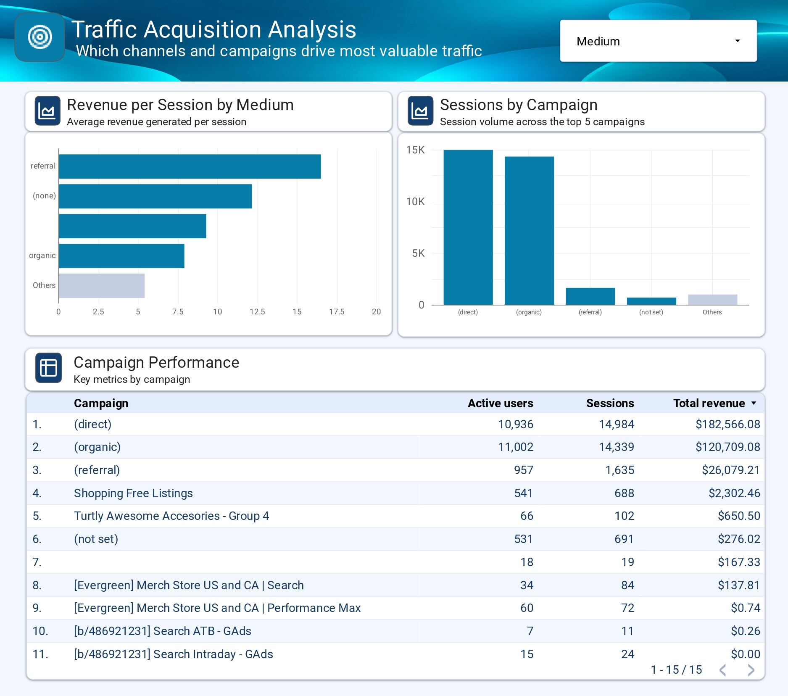

# E-commerce Performance Dashboard | Looker Studio & GA4

A two-page e-commerce analytics dashboard built with **Looker Studio** using the **Google Analytics 4 (GA4) demo dataset**.

The project explores revenue performance, customer activity, traffic acquisition, and campaign-level results through interactive visualizations.

## Dashboard Preview

### 1. Executive Overview

Highlights:
- Total revenue and purchaser KPIs
- Sessions and active user metrics
- Daily revenue trends by traffic medium
- Revenue and sessions by traffic medium

### 2. Traffic Acquisition Analysis

Highlights:
- Revenue per session by traffic medium
- Session volume across leading campaigns
- Campaign performance table with active users, sessions, and revenue

## Tools Used

- **Looker Studio** — dashboard design and interactive reporting
- **Google Analytics 4** — e-commerce demo data
- **GitHub** — project documentation and portfolio hosting

## Skills Demonstrated

- KPI selection and performance reporting
- Time-series and categorical data visualization
- Traffic acquisition analysis
- Calculated metrics, including revenue per session
- Dashboard layout, visual hierarchy, and data storytelling

## Data Notes

This project uses demo analytics data. Results depend on the selected reporting date range. Some campaign names may be blank or marked as not set in the source data.

## Live Dashboard

[View the interactive Looker Studio report](https://datastudio.google.com/reporting/0841c8ad-6d00-447a-9f30-ba73a2563474)

